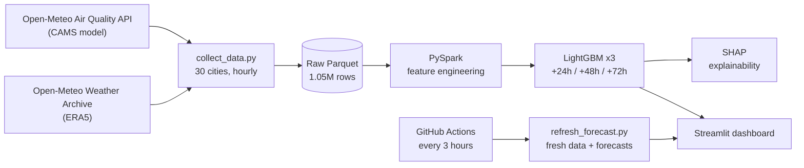

# Air_Quality_Forecast

# Air Quality Forecasting Dashboard: 24/48/72-hour PM2.5 for 30 cities

**Live demo: https://airqualityforecast-nmjcejreqplygdpxmefshu.streamlit.app/?city=Dhaka ** · Built with PySpark, LightGBM, SHAP, Streamlit and GitHub Actions


Dhaka is one of the most polluted cities in the world, and its modeled PM2.5 averaged **48.7 µg/m³** over the study period, roughly 10 times the WHO annual guideline of 5 µg/m³. This project builds an end-to-end, automated pipeline that forecasts fine-particle pollution 1 to 3 days ahead for Dhaka and 29 other cities, explains what drives the forecasts, and serves everything in an interactive dashboard.

## Highlights

- **1,049,760 hourly records** for 30 cities (Nov 2022 – Oct 2026), combining air-quality and weather variables from two free APIs.
- **PySpark feature engineering**: 45 model features (lags up to 7 days, rolling statistics, weather aggregates, cyclical time encodings) and three forecast targets (+24h, +48h, +72h).
- **LightGBM models beat a persistence baseline at every horizon**: MAE 11.9% to 18.5% lower, RMSE 17.2% to 22.1% lower on a full held-out year (Nov 2025 – Oct 2026).
- **Leakage-safe evaluation**: strict time-based train/validation/test split with a 72-hour gap between sets.
- **Explainability with SHAP** (exact TreeSHAP values) showing which inputs drive forecasts, overall and for Dhaka.
- **Automated**: a GitHub Actions workflow refreshes data and forecasts every 3 hours; the dashboard redeploys from the updated files.
- **Interactive dashboard** (7 tabs): forecast gauge with health guidance, live map, animated 4-year "time machine", hour-by-month pollution heatmap, city comparison, a what-if lab, and model diagnostics. Weather and smog animations reflect current conditions.

## Architecture



## Data

| | |
|---|---|
| Air quality | [Open-Meteo Air Quality API](https://open-meteo.com/en/docs/air-quality-api): PM2.5, PM10, NO₂, O₃, CO, US AQI (CAMS atmospheric model) |
| Weather | [Open-Meteo Historical Weather API](https://open-meteo.com/en/docs/historical-weather-api): temperature, humidity, wind, pressure, precipitation, cloud cover (ERA5) |
| Coverage | 30 cities on 6 continents, hourly, 2022-11-01 to 2026-10-28 |
| Size | 1,049,760 raw rows; 1,044,720 rows × 51 columns after feature engineering |

**Important:** these are *modeled* values for one grid point per city, not ground-station measurements. They can differ from local monitors.

## Method

1. **Collect**: hourly data for each city, one year at a time, with retries for timeouts and rate limits.
2. **Process (PySpark, local mode)**: de-duplicate, forward-fill gaps, clip negatives, then window functions per city for lags (1h to 168h), rolling mean/std/max, 24-hour weather aggregates, pressure change, and sine/cosine encodings of hour, day of year and wind direction. Targets are the PM2.5 value 24, 48 and 72 hours ahead.
3. **Split by time** (never randomly):

   | Set | Period | Rows |
   |---|---|---|
   | Train | Nov 2022 – Apr 2025 | 649,440 |
   | Validation (early stopping) | May – Oct 2025 | 130,320 |
   | Test | Nov 2025 – Oct 2026 | 260,640 |

4. **Model**: one LightGBM regressor per horizon (63 leaves, learning rate 0.05, early stopping on validation MAE), with the city as a categorical feature.
5. **Baseline**: persistence ("PM2.5 in *h* hours equals PM2.5 now"), a hard benchmark for short-range pollution forecasts.
6. **Explain**: exact TreeSHAP contributions on 45,000 test rows (1,500 per city).
7. **Uncertainty**: the dashboard's shaded 80% range comes from the 10th and 90th percentiles of each city's test-period errors.

## Results (test set: Nov 2025 – Oct 2026, never used for training)

| Horizon | Model | MAE (µg/m³) | RMSE (µg/m³) |
|---|---|---|---|
| +24h | Persistence | 14.67 | 29.24 |
| +24h | **LightGBM** | **12.92** | **24.21** |
| +48h | Persistence | 17.58 | 33.98 |
| +48h | **LightGBM** | **14.60** | **26.66** |
| +72h | Persistence | 18.59 | 35.18 |
| +72h | **LightGBM** | **15.15** | **27.41** |

| Horizon | MAE reduction vs persistence | RMSE reduction vs persistence |
|---|---|---|
| +24h | 11.9% | 17.2% |
| +48h | 17.0% | 21.5% |
| +72h | 18.5% | 22.1% |

**Dhaka only** (LightGBM test MAE): 12.9 µg/m³ at +24h, 15.1 at +48h, 15.6 at +72h. For context, Dhaka's average PM2.5 is about 49 µg/m³.

The advantage over persistence grows with the horizon, as expected: today's value is a good guess for tomorrow, but weather and seasonality matter more further ahead.

### What drives the forecasts (SHAP)

| Feature group | Share of model influence (all cities) | Dhaka |
|---|---|---|
| Recent PM2.5 history | 70.3% | 71.7% |
| Weather | 12.0% | 11.6% |
| Location | 8.9% | 8.7% |
| Other pollutants | 4.5% | 3.6% |
| Time / season | 4.3% | 4.4% |

In Dhaka, 24-hour accumulated rainfall is among the most influential weather features, consistent with precipitation washout. SHAP describes what the *model* relies on; it does not prove causal effects. Co-emitted pollutants such as CO act as proxies for combustion sources.

## Dashboard

- **Forecast**: "look-ahead" slider with an animated gauge, EPA-category health guidance, 80% range, and CSV download.
- **Live map**: all 30 cities by current or forecast PM2.5, with a ranking table.
- **Time machine**: animated map and "pollution race" over 48 months.
- **Patterns & compare**: hour-by-month heatmap, cleanest and dirtiest hours, year-over-year seasonality, multi-city comparison.
- **What-if lab**: change wind, humidity, temperature or rain and see the trained model's response.
- **Model performance** and **Why? (SHAP)** tabs.
- Weather and air-quality visual effects (sun, clouds, rain, snow, fog, storm, smog) with an on/off switch.

## Automation

`.github/workflows/daily_refresh.yml` runs every 3 hours (and on demand). It downloads the last 14 days of data for all cities, rebuilds the features, runs the three trained models, and commits the refreshed files in `data/dashboard/`. Streamlit Community Cloud redeploys from the repository. The pandas feature code used by the automation is checked against the Spark pipeline with `src/verify_features.py`.

## Limitations

- **Modeled data, not station readings.** Results describe the CAMS/ERA5 model world; real monitors can differ. Validating against ground stations (e.g. OpenAQ) is the natural next step.
- **Training and live weather differ slightly.** Models were trained on ERA5 reanalysis, while live runs use Open-Meteo's recent analysis/forecast weather.
- **Three forecast horizons, not a full hourly path.** The dashed forecast line joins +24h, +48h and +72h predictions.
- **One test year.** It contains a full seasonal cycle, but results could shift in an unusual year.
- **Single grid point per city**, so intra-city differences are not captured.
- **Prophet and deep-learning baselines were not evaluated.** The comparison is persistence vs. LightGBM.
- **Local time is estimated from longitude** in the dashboard (about ±1 hour).
- **SHAP is descriptive, not causal.**
- The free hosting tier may put the app to sleep after inactivity; the first load can take a moment.

## Run it yourself

```bash
git clone https://github.com/YOUR-USERNAME/YOUR-REPO.git
cd YOUR-REPO
python -m venv .venv
source .venv/bin/activate          # Windows: .venv\Scripts\activate
pip install -r requirements-dev.txt

python src/collect_data.py         # download data (about 15-25 min)
python src/process_spark.py        # PySpark features (needs Java 17)
python src/train_models.py         # train and evaluate LightGBM
python src/explain_shap.py         # SHAP plots and tables
python src/make_dashboard_data.py  # small files for the app
python src/make_extra_data.py
streamlit run app/streamlit_app.py
```

On Windows, Spark may fail to read Parquet without Hadoop's `winutils`; the script therefore reads the raw files with pandas and hands them to Spark for all processing.

## Repository structure

```
├── app/                    Streamlit dashboard (streamlit_app.py, effects.py)
├── src/                    pipeline: collect, process, train, explain, refresh
├── models/                 trained LightGBM models, metrics, feature list
├── data/dashboard/         small data files the app reads (auto-refreshed)
├── assets/                 SHAP plots and screenshots
├── .github/workflows/      scheduled refresh
├── requirements.txt        dependencies for the deployed app
└── requirements-dev.txt    full local environment
```

## Acknowledgements and license

Weather and air-quality data by [Open-Meteo.com](https://open-meteo.com/) (CC BY 4.0), derived from Copernicus Atmosphere Monitoring Service (CAMS) and ERA5 reanalysis data. Contains modified Copernicus Atmosphere and Climate Change Service information.

Code released under the MIT License.

**Author:** MD. ZOBAYER 